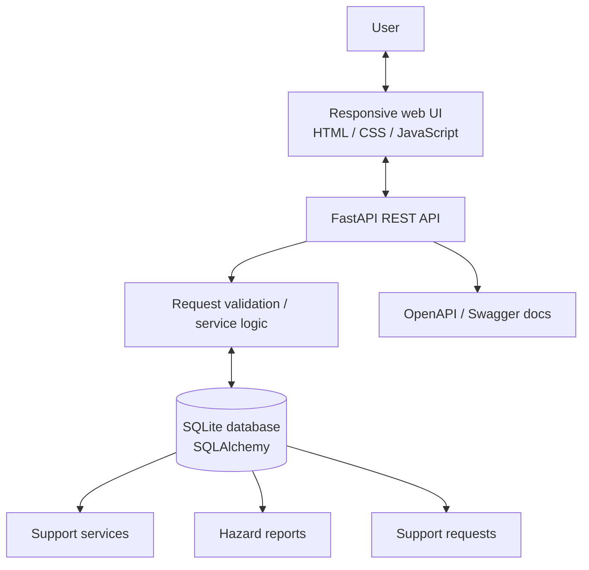

# SAATHI — Trusted Safety Support Network

**Initial working starter project** based on the supplied Stitch UI concept ZIP and its *Sanctuary Quietude* design system.

SAATHI is a privacy-conscious prototype that brings together a support-service directory, community public-space hazard reporting, and an optional support-preference workflow. This is a development starter, not a production emergency-response service.

## What's included

- A responsive frontend based on the provided UI direction: home, support finder, hazard reporting, and private support views.
- A FastAPI REST backend with interactive OpenAPI docs.
- SQLite persistence with SQLAlchemy models.
- Seeded sample support directory entries, explicitly marked as **demo listings / not verified**.
- Create/list hazard reports with reference codes.
- Create support-preference requests and return a private reference code in the submission response. There is no public request-lookup endpoint, to avoid exposing sensitive requests by reference-code guessing.
- A quick-exit visual switch to a neutral demo screen. It does **not** clear browser history, network logs, or other device records.
- Design reference HTML, screenshots, and design-system documentation copied from the provided archive.

## Project context

The project addresses **PS 09 — Improving Access to Trusted Safety Support**. Its goals and scope are documented in [`docs/PROJECT_BRIEF.md`](docs/PROJECT_BRIEF.md), based on the project information previously provided. The prototype focuses on support discovery, public-space hazard reporting, and private support preferences.

## Initial architecture



### Main workflows

1. **Support finder:** search and filter directory entries. The starter seed data is not a claim of live availability or local verification.
2. **Hazard reporting:** submit a category, text location, description, and optional coordinates. The API stores the report and returns a reference code. No authority is contacted automatically.
3. **Private support preference:** save a support category and contact preference. The demo does not contact any provider; submitted optional messages are stored in the local database.
4. **Health check:** `/api/v1/health` confirms that the API is reachable.

## Requirements

- Python 3.10 or newer (Python 3.11 or 3.12 recommended).
- pip.
- A modern browser.
- Internet access only for the optional Google Fonts stylesheet; the app itself is served locally.

Python packages are listed in [`requirements.txt`](requirements.txt).

## Run locally (Windows PowerShell)

Open PowerShell in the project root folder.

### 1. Create and activate a virtual environment

```powershell
py -m venv .venv
.\.venv\Scripts\Activate.ps1
```

If PowerShell blocks activation, either use `Set-ExecutionPolicy -Scope Process -ExecutionPolicy Bypass` for that terminal session, or run the virtual environment's Python executable directly.

### 2. Install dependencies

```powershell
python -m pip install --upgrade pip
pip install -r requirements.txt
```

### 3. Start the backend

```powershell
uvicorn app.main:app --app-dir backend --reload --port 8000
```

Keep this terminal open. Check these URLs:

- API health: http://127.0.0.1:8000/api/v1/health
- API documentation: http://127.0.0.1:8000/docs
- Root status: http://127.0.0.1:8000/

The database file `saathi.db` is created in the directory from which Uvicorn is launched. On first startup, sample directory entries are inserted if the services table is empty.

### 4. Start the frontend

Open a **second** terminal in the project root:

```powershell
python -m http.server 5500 --directory frontend
```

Open http://127.0.0.1:5500.

The frontend calls `http://127.0.0.1:8000/api/v1` by default. To override it, set `window.SAATHI_API_BASE` in `frontend/index.html` before `js/app.js` is loaded.

### macOS / Linux

```bash
python3 -m venv .venv
source .venv/bin/activate
python -m pip install --upgrade pip
pip install -r requirements.txt
uvicorn app.main:app --app-dir backend --reload --port 8000
```

In another terminal, from the project root:

```bash
python -m http.server 5500 --directory frontend
```

## API endpoints

| Method | Endpoint | Purpose |
|---|---|---|
| GET | `/api/v1/health` | Health check |
| GET | `/api/v1/services` | List services; optional `q` and `category` filters |
| GET | `/api/v1/services/{service_id}` | Get one service |
| POST | `/api/v1/hazards` | Create a public-space hazard report |
| GET | `/api/v1/hazards` | List recent hazard reports; optional `status` filter |
| POST | `/api/v1/support-requests` | Save a support preference/request |

Example hazard request:

```json
{
  "category": "streetlight",
  "description": "Streetlight appears to be broken on the footpath.",
  "location_text": "Near the main bus stop",
  "latitude": null,
  "longitude": null
}
```

Example support preference request:

```json
{
  "support_type": "counselling",
  "preferred_contact": "self-directed",
  "message": "Please show information about available options.",
  "consent": true
}
```

## Project structure

```text
saathi_project/
├── README.md
├── requirements.txt                 # Runtime dependencies
├── requirements-dev.txt             # Runtime + test dependencies
├── .env.example                     # Example environment configuration
├── .gitignore
├── backend/
│   ├── README.md
│   └── app/
│       ├── __init__.py
│       ├── main.py                  # FastAPI app, CORS, startup and seed lifecycle
│       ├── api/
│       │   ├── __init__.py
│       │   └── routes.py             # REST API endpoints
│       ├── core/
│       │   ├── __init__.py
│       │   └── config.py             # Environment configuration
│       ├── db/
│       │   ├── __init__.py
│       │   └── session.py            # SQLAlchemy engine, session and base
│       ├── models/
│       │   ├── __init__.py
│       │   └── entities.py           # Database entities
│       ├── schemas/
│       │   ├── __init__.py
│       │   └── api.py                # Pydantic request/response schemas
│       └── services/
│           ├── __init__.py
│           └── seed.py               # Unverified demo service listings
├── frontend/
│   ├── index.html                   # Four UI views and navigation
│   ├── css/styles.css               # Sanctuary Quietude-inspired styling
│   └── js/app.js                    # API integration and UI behavior
├── tests/
│   ├── conftest.py                  # Isolated test database and API client
│   └── test_api.py                  # API smoke and privacy contract tests
└── docs/
    ├── PROJECT_BRIEF.md             # Prior PS 09 project context and scope
    ├── ARCHITECTURE.md              # Components, flows, entities and endpoints
    └── design_reference/
        ├── DESIGN_SYSTEM.md
        ├── code.html
        ├── screen.png
        ├── safety_home_assessment.html / .png
        ├── smart_support_finder.html / .png
        ├── community_safety_hazard_reporting.html / .png
        └── private_support_confidential_referrals.html / .png
```

## Run API tests

```powershell
python -m pip install -r requirements-dev.txt
pytest -q
```

Tests use a separate local SQLite database named `saathi_test.db`. It is ignored by Git.

## Configuration

Copy `.env.example` to `.env` to customize settings. The defaults work for local development. `DATABASE_URL` can later be changed to a PostgreSQL SQLAlchemy URL after installing a matching database driver and configuring a database. Do not commit secrets or production credentials.

## Privacy, safety, and limitations

This project handles a sensitive domain. Before any real deployment:

- Replace sample directory entries with verified, maintained information and a clear verification process.
- Review applicable privacy, child safeguarding, data protection, and reporting obligations with qualified stakeholders.
- Add authentication/authorization for administrative workflows, rate limiting, abuse controls, audit logging, encryption, retention limits, and secure deployment configuration.
- Define who can see support requests, who is responsible for follow-up, and how requests are deleted.
- Do not imply that reports reach police or local authorities unless an actual, tested integration exists.
- Do not promise anonymity or absolute confidentiality. This version stores submitted information in SQLite and has no account system or caseworker console.
- Keep emergency contacts easy to access, but validate the current service details and local operating conditions before deployment.
- Quick Exit only switches the visible page. It cannot erase browser history, server logs, ISP records, or device activity.
- The current hazard view is a report list with a decorative map-like panel, not a real geographic map or verified safe-route engine. Exact coordinates, if supplied, are stored but omitted from public hazard API responses.

## Next recommended development steps

1. Run the automated API tests with `pip install -r requirements-dev.txt` followed by `pytest`.
2. Add a proper migration workflow (Alembic).
3. Build a secured admin review process for service verification and hazard moderation.
4. Add real map rendering only after defining coordinate privacy and moderation rules.
5. Add multilingual UI content and accessibility testing with intended users.
6. Design and test a consent-based referral integration with partner organizations.
7. Perform a security and privacy review before storing real survivor data.

## License and attribution

This starter project is generated for development from the supplied SAATHI UI concept archive. Review the original design assets and any third-party assets before redistribution or production use.
