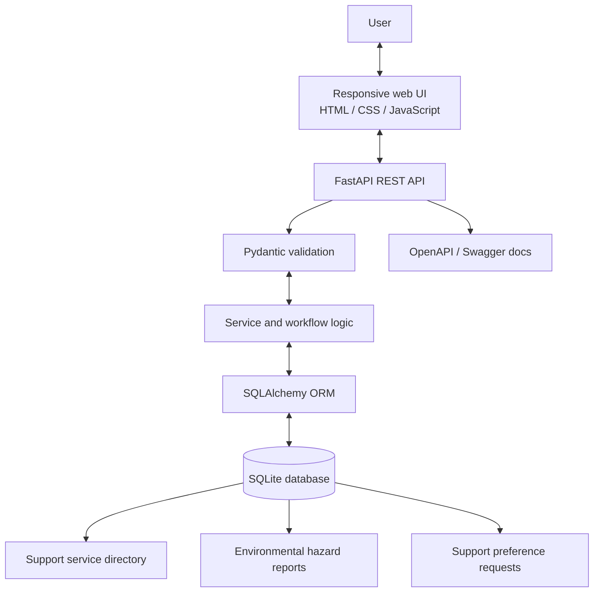

# SAATHI — Initial Architecture

## Context and scope

This architecture implements the first working prototype for **PS 09 — Improving Access to Trusted Safety Support**. It follows the supplied Stitch UI concepts and the Sanctuary Quietude design direction. The product combines support discovery, community hazard reporting, and a private support-preference flow.

## Component architecture

## Main user flows

### Support discovery

1. User opens the Support Finder.
2. The frontend sends an optional search query and category filter to `GET /api/v1/services`.
3. FastAPI validates query parameters and queries the directory through SQLAlchemy.
4. The UI displays service type, description, area, accessibility notes, verification state, and available contact links.
5. Seeded entries remain visibly unverified until an administrator-led verification process exists.

### Public-space hazard report

1. User selects a hazard category and enters a location description and issue details.
2. Coordinates are optional and are never requested automatically.
3. The API validates the payload and stores the report in SQLite.
4. The API returns a generated reference code and a received status.
5. The report is not forwarded to an authority. Public API responses omit exact coordinates in this starter version.

### Private support preference

1. User chooses a support type and preferred next step.
2. The UI explains what the demo stores and requires an explicit consent checkbox.
3. The API stores the selected category, contact preference, and optional message.
4. The response contains a reference code and status, but no provider is contacted.
5. There is no unauthenticated public endpoint to retrieve a stored support request by reference code.

## Backend layers

- `app/main.py`: FastAPI application, lifespan, schema creation, CORS, and router registration.
- `app/api/routes.py`: REST endpoints and request handling.
- `app/core/config.py`: environment-backed settings.
- `app/db/session.py`: SQLAlchemy engine, session factory, and declarative base.
- `app/models/entities.py`: persistence models.
- `app/schemas/api.py`: Pydantic input/output contracts.
- `app/services/seed.py`: one-time demo directory seed data.

## Data entities

- **SupportService:** category, description, contact links, area, accessibility notes, verification flag, and last verification time.
- **HazardReport:** reference code, hazard category, description, text location, optional coordinates, status, and creation time.
- **SupportRequest:** reference code, support type, preferred contact, optional message, status, and creation time.

## API contract

| Method | Path | Purpose |
|---|---|---|
| GET | `/api/v1/health` | API health check |
| GET | `/api/v1/services` | List/search services; supports `q` and `category` |
| GET | `/api/v1/services/{service_id}` | Read a service entry |
| POST | `/api/v1/hazards` | Create a hazard report |
| GET | `/api/v1/hazards` | List recent hazard reports; optional status filter |
| POST | `/api/v1/support-requests` | Save a support preference with consent |

## Configuration and persistence

Configuration is read from environment variables and `.env` through Pydantic Settings. Defaults are designed for local development. SQLite is used to reduce setup friction; PostgreSQL/PostGIS is a possible later migration if geographic queries become necessary.

## Explicit non-goals for this prototype

- No live dispatch, police integration, SMS alert, or provider referral.
- No GPS tracking or automatic location capture.
- No AI model that scores survivors, credibility, or incident truthfulness.
- No real safe-route guarantee or live map provider integration.
- No authentication or admin portal yet.
- No claim that demo listings are currently verified or available.

## Before production

Add authentication and role-based authorization, hazard moderation, secure request access, rate limiting, abuse prevention, encryption, audit logging, retention/deletion policies, multilingual and accessibility testing, verified provider operations, and a legal/privacy/safeguarding review. Any referral integration should be consent-based and agreed with partner organizations.
